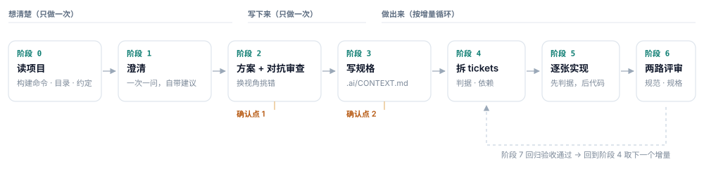

# AI 开发工作流

> **AI 工作开发** —— 一套规格驱动的 AI 编程流程：先想清楚，再写下来，然后按小增量做出来，每一步都留下可验收的证据。

适用于任何用 AI 写代码的场景，不绑定特定编辑器、插件或模型。



## 它解决什么

AI 写代码很快，但「快」不等于「对」。这套流程针对四种几乎人人都会遇到的失效：

| 失效 | 表现 | 解法 |
| --- | --- | --- |
| 对话一长就忘 | 上下文被压缩，前面定过的约束慢慢丢失，越写越偏 | 规格外置到 `.ai/CONTEXT.md` |
| 自己审自己 | 方案是它出的，审查也是它做的，结论必然「合理」 | 审查换一个没参与过的立场 |
| 测试变成背书 | 先写代码再补测试，测试只是给现有行为拍张照 | 先定判据，跑红再实现 |
| 一次改太多 | 一个提交几十个文件，出问题无法定位，不敢回滚 | 一张 ticket 一次改动 |

一句话：**该记住的写进文件，该质疑的换个人来质疑，该验证的变成能跑的东西，该交付的切成小块。**

## 安装

### WorkBuddy / CodeBuddy

Skill 目录位于用户主目录下的 `.workbuddy/skills/`（旧版 CodeBuddy 为 `.codebuddy/skills/`）。

macOS / Linux：

```bash
git clone git@github.com:Sbw-disciple/ai-dev-workflow.git ~/.workbuddy/skills/ai-dev-workflow
```

Windows PowerShell：

```powershell
git clone git@github.com:Sbw-disciple/ai-dev-workflow.git "$env:USERPROFILE\.workbuddy\skills\ai-dev-workflow"
```

手动安装：把本仓库整个目录复制到 `~/.workbuddy/skills/ai-dev-workflow`，重启客户端，在技能列表里确认已加载。

### 其他 AI 编程工具

没有 skill 机制也能用。把 `SKILL.md` 作为项目规则文件引入：

- Claude Code：放到项目根的 `CLAUDE.md`
- Cursor：放到 `.cursor/rules/`
- 其他工具：作为系统提示的一部分，或每次对话开头发给模型

流程本身不依赖任何工具特性，只要求模型能读写项目文件。

## 用法

触发方式：直接描述你要做的事，或说出关键词。

```
我要给记录页加一个按日期筛选的功能
按流程来，先写规格
帮我拆一下这个需求
review 一下这次的改动
```

会触发流程的场景：新功能、跨 3 个以上文件的改动、重构、清理死代码、修复杂 bug。

不会触发（直接做）：改文案、调颜色、改一个数值、单文件 20 行以内的明确改动。

## 七个阶段

```
阶段 0  读项目            静默执行，不问用户
阶段 1  澄清              一次一个问题，每个问题自带建议答案
阶段 2  方案 + 对抗审查    换视角挑错，合并后再给用户看   ── 确认点 1
阶段 3  写规格 .ai/CONTEXT.md                        ── 确认点 2
阶段 4  拆 tickets .ai/tickets.md
阶段 5  逐张实现           先判据，后代码
阶段 6  两路评审 .ai/review.md
阶段 7  回归验收           按规格逐条过
```

人的介入点只有两个：确认方案、确认规格。其余交给模型，但每一步都有文件留痕。

## 产物

```
项目根/
└── .ai/
    ├── CONTEXT.md    规格：目标、范围、验收标准、约束、子任务
    ├── tickets.md    子任务清单与状态
    └── review.md     两路评审记录与回归结果
```

这三个文件应当提交进项目仓库，它们是团队共享的决策记录。

初始化：

```bash
python3 scripts/init_workspace.py .   # Windows 用 python
```

脚本会在当前目录生成 `.ai/` 和三个模板文件，已存在的文件默认跳过。加 `--lite` 只生成精简版规格，适合小需求。

## 没有测试框架怎么办

移动端、小程序、桌面端项目常常没有可用的单测。不硬套 TDD，但要保住它想要的东西——可执行的验收判据：

- 纯逻辑（计算、换算、解析、状态机）抽成不依赖 UI 的函数，这部分必须有测试或验证脚本
- UI 与交互用验收判据代替：进入页面看到什么、点击后发生什么、异常输入如何提示
- 每次只回归受影响页面，控制手动成本

写不出判据的地方，往往就是需求没想清楚的地方，回到澄清阶段。

## 目录结构

```
ai-dev-workflow/
├── SKILL.md                      技能主文件，模型加载的入口
├── README.md
├── LICENSE
├── CHANGELOG.md
├── assets/
│   └── workflow.svg              流程框架图
├── references/
│   ├── spec-template.md          规格模板
│   ├── tickets-template.md       任务拆分模板与粒度示例
│   ├── review-checklist.md       两路评审清单
│   ├── antipatterns.md           五种误用
│   └── origin.md                 来源与改造说明
└── scripts/
    └── init_workspace.py         初始化 .ai/ 目录
```

## 来源

流程骨架来自一位开发者公开分享的九步实践（`/grill-me` → `/to-spec` → `/to-tickets` → `/tdd` → `/code-review`）。本仓库剥离了与特定插件的绑定，改写为七个阶段，并补充了无测试框架时的降级方案。详见 [references/origin.md](references/origin.md)。

## License

[MIT](LICENSE)
